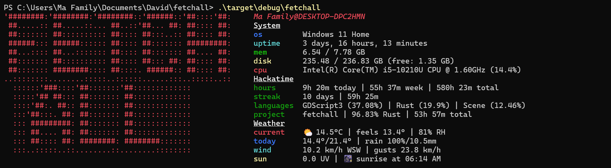
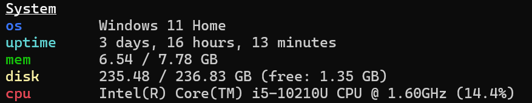
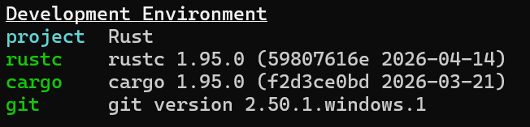
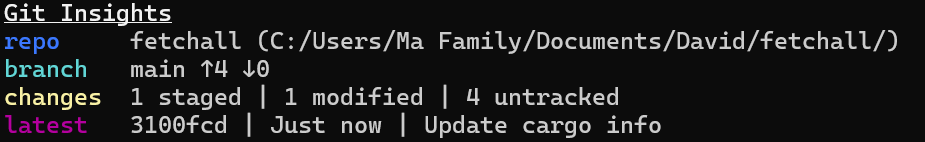
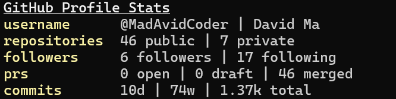
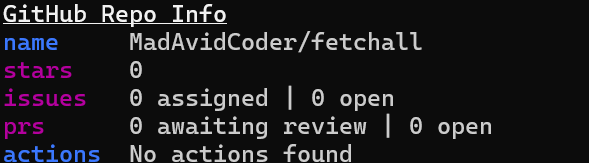
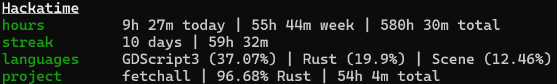
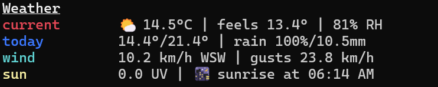
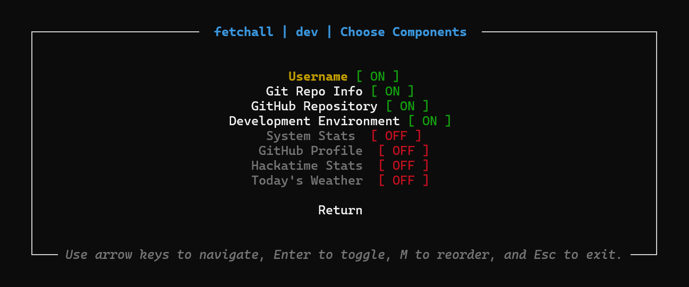
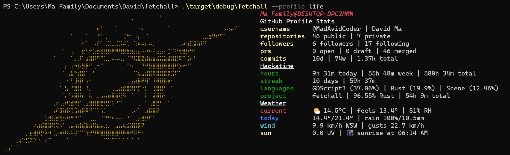

# fetchall

_**Fetchall**_ is a CLI tool inspired by neofetch, and geared towards developers. It brings information from across many different sources, giving a more comprehensive overview of your system, dev environments, coding stats, and even the weather. It is written in Rust, and designed to be easy to use, and highly customisable and modular, allowing you to make it your own personal terminal dashboard.

## Features

- **Neofetch style output**
- **Lots of components**
- **Easy configuration and customisation**
- **OAuth API support for GitHub and Hackatime**
- **Supports custom ASCII art**
- **Modular support for development**

## Installation and Setup

_Fetchall_ can be downloaded in two ways.

### Install from [GitHub Releases](https://github.com/MadAvidCoder/fetchall/releases/latest) _(easiest)_

Go to [https://github.com/MadAvidCoder/fetchall/releases/latest](https://github.com/MadAvidCoder/fetchall/releases/latest) and download the release for your system.

Move the executable file onto path, enable execution _(you may need to override SmartScreen/Gatekeeper/etc warnings. This is completely safe, and you can check all code if concerned.)_ then restart your shell.

### Install from [crates.io](https://crates.io/crates/fetchall) _(best for Rust users)_

Run `cargo install fetchall` to install the crate to your system.

### Setup

Once you have successfully installed it, you should be able to run `fetchall` immediately. However, to enable all features, you must run `fetchall config`, go to the `Integrations` menu, and allow fetchall to access your GitHub and Hackatime accounts (more info later).

You are also able to customise fetchall to your liking, from the `fetchall config` wizard. More information below.

## About

### Components

_Fetchall_ is designed to be modular, with every source of information forming a 'component'. Each profile has a set of components, allowing users to customise what gets shown.

Currently, fetchall includes the following components:

- **Username**
  

  This is a minimal one-line component which displays your username and device hostname. Included by default in all profiles.

- **System information**
  

  The system information component compiles key information about your current system, including the OS, uptime, CPU, RAM, and more. It mimics the core features of neofetch, and is the base of _fetchall_.

- **Development Environment**
  

  This component intelligently detects whether you are inside a folder with files associated with a known language, and shows the versions of relevant tools and compilers for that language. It currently supports Rust, Node.js, Python _(if you have a pyproject.toml)_, Go, C/C++ and Java.

- **Git**
  

  If you are inside a Git directory, _fetchall_ can display working tree changes, the latest commit, and incoming/outgoing changes to the upstream branch.

- **Github Profile**

  > [!TIP]
  > _Connect to GitHub with `fetchall auth github` to use._

  

  After connecting to the GitHub API, this component will display informations about the authenticated github user, including the number of repos, followers, PRs, commits.

- **Github Repo**

  > [!TIP]
  > _Connect to GitHub with `fetchall auth github` to use._

  

  If inside a git repository, with an upstream GitHub repo, this component will show useful information from the GitHub API, such as whether the latest action runs were successful, or if there are PRs awaiting the authenticated user's review.

- **Hackatime**

  > [!TIP]
  > _Connect to Hackatime with `fetchall auth hackatime` to use._

  

  This component will show how ~~much much of your life has been wasted building random useless stuff~~ long you've spent coding. It can also show your current streak, including how many hours across that period. If in an active project folder, it will show how long's been spent on the current project.

- Weather information

  > [!NOTE]
  > _No API authentication needed_

  

  A less development orientated tool, but this component uses the free Open Meteo API to fetch the latest weather for your location _(estimated based on IP, not GPS, for privacy)_. It also shows when the next sunset or sunrise is, because you know that you spend too much of the night coding xD

### Profiles

_fetchall_ allows the use of 'profiles' to control which components get shown when you run a fetch. To manage these profiles, launch the interactive configuration wizard using `fetchall config`, and go to the `Profiles` menu.

You can modify, rename, delete, and make new profiles here. Once you have created/selected a profile, press `SPACE` to toggle the selected component on/off. To reorder, press `M` and then use the arrow keys to move the selected component up and down.

To use a custom profile, run `fetchall --profile <NAME>`.

### Visuals

One of the best features of neofetch is the ASCII art, and fetchall emulates this feature. By default, fetchall will display ASCII art of your OS logo, if it can detect it correctly.

To customise the looks of fetchall, run `fetchall config` and go to the `Appearance` menu. Here you can control the logo, the colours, and the layout.

Within the logos menu, you can choose between `Automatic` _(which displays your OS logo)_, `Override OS Logo` _(if for some reason you want to larp having a different OS)_, `fetchall logo` _(FetchAll written in cool ASCII art)_, or a `Custom ASCII file` _(a plaintext file which contains ASCII art. For best results keep it to around 45cols x 30rows ish)_.

Within the `Colour Scheme` menu, you can override the colour for the logo _(\*recommended if you use a custom ascii file)_, or set the colour of all the labels, to suit your rice better.

You can also customise the `Layout`, including the gap between the logo, whether to show component titles, whether to have gaps between components, etc. To alter the numeric variables use the Left/Right arrow keys.

### APIs

To get useful information, fetchall uses four APIs, which will require network access and authentication.

#### GitHub

The GitHub API provides info about your GitHub repos, and must be authenticated. In the config wizard, go to `Integrations`, and select `GitHub`. This will bring up a link (which should automatically open) and code (which will hopefully copy to your clipboard automatically). Go to the link, paste the code, and authorise the device. This will allow _fetchall_ to generate a token, which is then stored **securely**, in the OS keystore.

Once you have done this, you need to install the _fetchall-cli_ app to your GitHub account, so it can retrieve information. Go to the second link it brings up, and install it, giving it read-only access to all private repos, to ensure _fetchall_ can retrieve accurate stats.

#### Hackatime

If you use [Hackatime](https://hackatime.hackclub.com/), _fetchall_ can use its API to retrieve stats about how long you spend coding. Select `Hackatime` in the integrations menu, and go to the link, log in, and approve _fetchall-cli_. Once _fetchall_ receives the verification callback, you can return to the main menu.

#### Open-Meteo & IP-API

To retrieve the weather, fetchall uses IP-API to identify your approximate location (not GPS accurate - fetchall respects your privacy) and requests weather data from Open-Meteo. Neither APIs require a key, so you don't need to do anything other than connect to WiFi for the Weather component to work.

## Development

### Tech Stack

- **Rust**: main programming language
- **clap**: CLI arg parsing
- **reqwest**: HTTP requests for APIs
- **OWOColors**: Colouring for the main _fetchall_ interface (no TUI library involved)
- **RataTUI and Crossterm**: TUI interface (Config menu only)
- **Sysinfo**: System specs and info
- **Git2**: Git repo integration
- **Serde & Serde JSON**: Serialisation of config and HTTP responses
- **TOML**: Storing configuration and settings
- **Keyring**: Secure credentials and secrets storage
- **Github Actions**: Executable Compilation

### Building from Source

You must have the [Rust toolchain installed](https://rust-lang.org/tools/install/) to compile _fetchall_.

Run `cargo build --release`. The compiled binary will be in `target/release/`.

### Modifying

_fetchall_ has been built using a modularised component structure. To add more functionality, you can create new components, which provide more information. Then, you can add these components to your profiles to use!

To do this, first create a new rust file in `src/components` _(I recommend you use [`src/components/system.rs`](/src/components/system.rs) as an example)_, and add it to [`src/components/mod.rs`](src/components/mod.rs), and [`src/component.rs`](src/component.rs). You can follow the example of the existing components, to understand the output structure.

### Contributing

Contributions are welcome! If you've found a bug, made a cool new component, or have ideas for new features, feel free to open an Issue or submit a Pull Request to help improve _fetchall_.

### License

_fetchall_ is licensed under the [GNU GPLv3 License](/LICENSE), welcoming modifications, improvements, and distributions of this program. However, to benefit the OSS community, any derivative works must be licensed under the same terms. See [LICENSE](/LICENSE) for full details.
